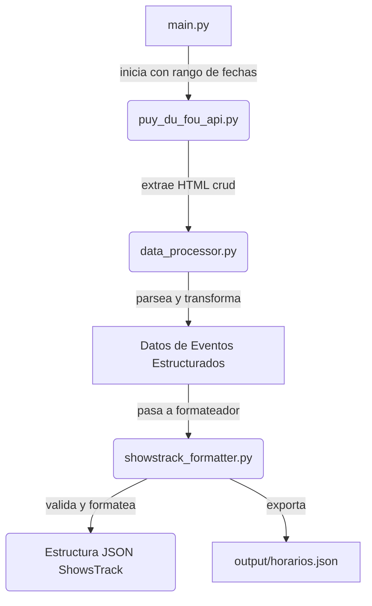

# 🔄 ShowsTrack APP - Sistema de Extracción e Integración

## 1. Visión General

Este documento describe el sistema de extracción de datos (ETL), una aplicación Python standalone que actúa como el puente automatizado entre la API de Puy du Fou España y la aplicación ShowsTrack.

Su responsabilidad principal es consultar la programación oficial, procesarla, validarla y formatearla en una estructura JSON estandarizada que el backend de ShowsTrack puede importar de manera segura y eficiente.

## 2. Arquitectura del Sistema de Extracción

El sistema está compuesto por varios módulos Python, cada uno con una responsabilidad única, que se orquestan para realizar el proceso completo.

### Estructura de Módulos
```
scripts/
├── main.py                    # Orquestador principal del flujo
├── puy_du_fou_api.py          # Cliente HTTP para la API de Puy du Fou
├── data_processor.py          # Lógica de parsing y transformación de datos
├── showstrack_formatter.py    # Formateo y validación para el API de ShowsTrack
├── excel_exporter.py          # Exportación a formato .xlsx
├── date_utils.py              # Utilidades para fechas y horas
├── debug/                     # Logs y archivos de depuración
└── output/                    # Archivos finales (.xlsx, .json)
```

### Flujo de Ejecución
El proceso sigue un flujo ETL (Extract, Transform, Load) clásico:



## 3. Flujo de Trabajo Detallado

### 3.1. Extracción (`puy_du_fou_api.py`)
*   **Acción**: Realiza una petición `GET` a la URL `https://api.mobile.puydufouespana.com/nagios?debug&date=YYYY-MM-DD`.
*   **Robustez**:
    *   Simula ser un navegador real usando headers `User-Agent`.
    *   Implementa un sistema de **3 reintentos con backoff exponencial** (esperando 2s, 4s, 8s) para manejar fallos de red o de la API.
    *   Valida que la respuesta HTTP sea `200 OK` y que contenga el texto clave `"Puy Du Fou DB Rows"` para asegurar que los datos son correctos.

### 3.2. Transformación (`data_processor.py`)
Esta es la fase más compleja, ya que traduce el formato de depuración PHP de la API en datos estructurados.

*   **Acción**:
    1.  Guarda la respuesta cruda en `debug/response_YYYY-MM-DD.txt` para auditoría.
    2.  Utiliza expresiones regulares (`regex`) para encontrar y extraer cada bloque de evento `array(8){...}`.
    3.  Para cada bloque, extrae los campos `Gh_evenementid`, `Gh_evenement`, `Gh_type`, `Gh_duree`, `Gh_heuredebut` y `Gh_heurefin`.
*   **Lógica de Negocio Clave (Hora de Fin)**:
    *   **Prioridad 1**: Si el campo `Gh_heurefin` tiene un valor, se utiliza ese valor directamente.
    *   **Prioridad 2**: Si `Gh_heurefin` está vacío, se calcula sumando la `Duración` a la `Hora Inicio`.
    *   **Validación**: Si ambos valores existen y no coinciden, el sistema prioriza el valor explícito (`Gh_heurefin`) pero registra una advertencia (`WARN`) en el log `debug/data_processor_diagnostic.log`.
*   **Salida**: Genera una lista de diccionarios Python, donde cada diccionario representa un evento. Esta lista se guarda en `debug/shows_YYYY-MM-DD.txt`.

### 3.3. Formateo y Carga (`showstrack_formatter.py`)
Este módulo es el **adaptador final** que prepara los datos para ser consumidos por ShowsTrack.

*   **Acción**:
    1.  Recibe la lista de eventos procesados.
    2.  Itera sobre cada evento y lo mapea al **contrato de la API de ShowsTrack**.
    3.  Realiza validaciones críticas en cada evento.

*   **Mapeo de Campos**:

| Campo ShowsTrack | Origen en Script | Transformación |
| :--- | :--- | :--- |
| `external_event_id` | `EventoID` | Directa |
| `show_name` | `Evento` | Directa |
| `event_date` | `Fecha` | Directa (formato `YYYY-MM-DD`) |
| `start_time` | `Hora Inicio` | Directa (formato `HH:MM`) |
| `end_time` | `Hora Fin` | Directa (formato `HH:MM`) |
| `duration_minutes` | `Duración` | Conversión a `integer` |
| `event_type` | `Tipo` | Mapeo (`Show` -> `show`, etc.) |

*   **Validaciones**:
    *   Un evento es **descartado** si no contiene `external_event_id`, `show_name`, `event_date` o `start_time`.
    *   Verifica que las fechas y horas tengan el formato correcto (`YYYY-MM-DD` y `HH:MM`).

*   **Salida Final (JSON)**:
    El módulo construye un objeto JSON final con dos claves principales: `metadata` y `events`. El `metadata` incluye un resumen estadístico muy útil (`extraction_summary`) con conteos por tipo, por show y por fecha.

## 4. Integración con el Backend de ShowsTrack

El archivo JSON generado por `showstrack_formatter.py` es la entrada para el `ImportSyncService` en el backend.

*   **Endpoint de Importación**: La intención es que este archivo JSON se envíe vía `POST` al endpoint `/api/admin/import/direct`.
*   **Sincronización**: El backend utilizará el `external_event_id` para realizar un "upsert":
    *   Si un evento con ese ID ya existe en esa fecha, lo actualizará si hay cambios.
    *   Si no existe, creará un nuevo registro.
*   **Trazabilidad**: Los metadatos (`extraction_time`, `source`, `version`) se registran en la tabla de auditoría de ShowsTrack para tener un historial completo de las sincronizaciones.

## 5. Despliegue y Automatización

Aunque este sistema puede ejecutarse manualmente, está diseñado para la automatización.

*   **Ejecución**: Se debe configurar un **trabajo cron** en el servidor donde resida este script.
*   **Frecuencia Recomendada**:
    *   **Una vez al día (madrugada)**: Para cargar la programación de los próximos 7 días.
      ```bash
      # A las 5:00 AM todos los días
      0 5 * * * /usr/bin/python3 /path/to/scripts/main.py --start-date $(date +\%Y-\%m-\%d) --end-date $(date -d '+7 days' +\%Y-\%m-\%d) --format json
      ```
    *   **Varias veces al día (opcional)**: Para capturar cambios de última hora en el día actual.
      ```bash
      # Cada 4 horas entre las 9 AM y las 9 PM
      0 9,13,17,21 * * * /usr/bin/python3 /path/to/scripts/main.py --start-date $(date +\%Y-\%m-\%d) --end-date $(date +\%Y-\%m-\%d) --format json
      ```
*   **Acción Post-Ejecución**: Tras generar el JSON, un paso adicional en el script debería ser enviarlo a la API de ShowsTrack.