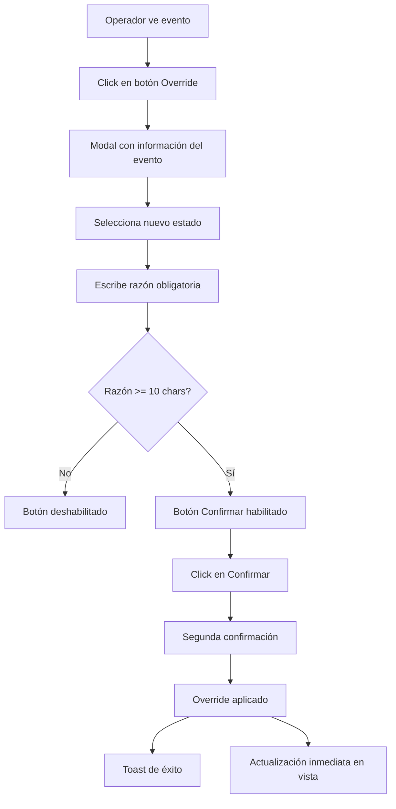
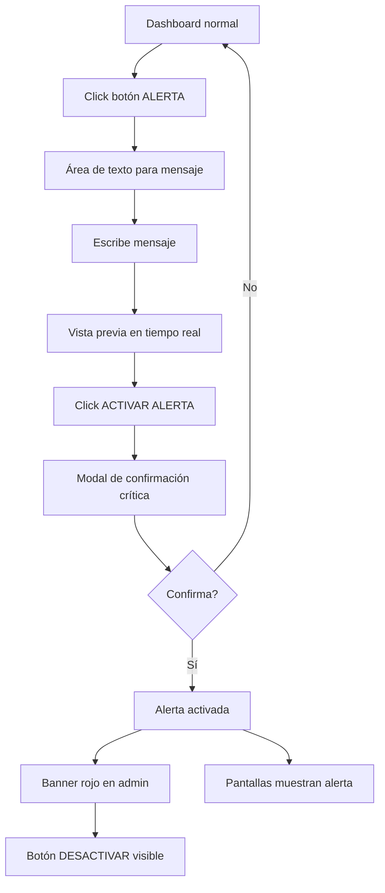

# 🖥️ ShowsTrack APP - Especificaciones de Interfaces de Usuario

### Tecnología y Arquitectura

**Stack Tecnológico**:
- HTML5 semántico
- CSS3 con variables CSS para theming
- JavaScript ES6+ vanilla (sin frameworks)
- Sin dependencias externas

**Justificación**:
- Máxima compatibilidad con sistemas embebidos
- Carga ultrarrápida y mínimo uso de recursos
- Mantenimiento simple sin complejidad de build
- Resiliente ante fallos de red o sistema

### Estructura de Archivos

```
frontend-public/
├── index.html              # Documento principal
├── css/
│   └── styles.css         # Estilos optimizados para pantallas
├── js/
│   ├── app.js            # Lógica principal
│   └── config.js         # Configuración centralizada
└── assets/
    ├── fonts/            # Fuentes locales para offline
    └── images/           # Logo y recursos visuales
```

## 5.1 Cliente Pantallas Públicas

### Diseño Visual y Layout

**Especificaciones de Pantalla**:
- Resolución objetivo: 1920x1080 (Full HD)
- Orientación: Horizontal (landscape)
- Distancia de visualización: 3-10 metros
- Ambiente: Interior con luz variable

**Layout Principal**:

```
┌─────────────────────────────────────────────────────┐
│                    HEADER (15%)                     │
│  Logo        HORARIOS DE ESPECTÁCULOS      14:30   │
├─────────────────────────────────────────────────────┤
│                                                     │
│                   CONTENIDO (70%)                   │
│                                                     │
│  ┌─────────────────────────────────────────────┐  │
│  │ # │ Espectáculo │ Hora │ Estado │ Próximo  │  │
│  ├───┼─────────────┼──────┼────────┼──────────┤  │
│  │ 1 │ Show A      │10:30 │ABIERTO │ 12:00    │  │
│  │ 2 │ Show B      │11:00 │PROGRAM │ ---      │  │
│  │ 3 │ Show C      │12:00 │CERRADO │ 14:00    │  │
│  │ 4 │ Show D      │14:30 │PROGRAM │ 16:30    │  │
│  │ 5 │ Show E      │15:00 │PROGRAM │ ---      │  │
│  └─────────────────────────────────────────────┐  │
│                                                     │
├─────────────────────────────────────────────────────┤
│                   FOOTER (15%)                      │
│  Información adicional · Última actualización       │
└─────────────────────────────────────────────────────┘
```

### Sistema de Estados Visuales

**Colores y Símbolos**:

| Estado | Color Hex | Color RGB | Símbolo | Contraste |
| :--- | :--- | :--- | :--- | :--- |
| PROGRAMADO | #6B7280 | 107,114,128 | 🕒 | AAA |
| ABIERTO | #10B981 | 16,185,129 | ✅ | AA |
| CERRADO | #EF4444 | 239,68,68 | ❌ | AA |
| CANCELADO | #F59E0B | 245,158,11 | ⚠️ | AA |

**Tipografía**:
```css
/* Jerarquía tipográfica para legibilidad a distancia */
.show-name {
  font-size: 3.5rem;    /* ~56px */
  font-weight: 700;
  line-height: 1.2;
}

.time-display {
  font-size: 3rem;      /* ~48px */
  font-weight: 600;
  font-variant-numeric: tabular-nums;
}

.status-text {
  font-size: 2.5rem;    /* ~40px */
  font-weight: 600;
  text-transform: uppercase;
}

.next-show {
  font-size: 2rem;      /* ~32px */
  font-weight: 400;
  opacity: 0.8;
}
```

### Lógica de Actualización Automática

**Configuración**:
```javascript
const CONFIG = {
  API_BASE_URL: '/api/public',
  UPDATE_INTERVAL: 30000,      // 30 segundos
  RETRY_DELAYS: [5000, 10000, 20000], // Backoff exponencial
  MAX_RETRIES: 3,
  CACHE_DURATION: 120000,      // 2 minutos para fallback
  ANIMATION_DURATION: 300      // ms para transiciones
};
```

**Flujo de Actualización**:

```javascript
class ShowsTrackClient {
  constructor() {
    this.currentData = null;
    this.lastValidData = null;
    this.retryCount = 0;
    this.updateTimer = null;
  }

  async start() {
    // Carga inicial inmediata
    await this.fetchAndRender();
    
    // Establecer ciclo de actualización
    this.updateTimer = setInterval(() => {
      this.fetchAndRender();
    }, CONFIG.UPDATE_INTERVAL);
  }

  async fetchAndRender() {
    try {
      const response = await fetch(`${CONFIG.API_BASE_URL}/schedules`);
      
      if (!response.ok) throw new Error(`HTTP ${response.status}`);
      
      const data = await response.json();
      
      // Validar estructura de datos
      if (!this.validateData(data)) throw new Error('Invalid data structure');
      
      // Actualizar vista
      this.currentData = data;
      this.lastValidData = data;
      this.retryCount = 0;
      
      this.render(data);
      
    } catch (error) {
      this.handleError(error);
    }
  }

  handleError(error) {
    console.error('Error fetching data:', error);
    
    // Incrementar contador de reintentos
    this.retryCount++;
    
    // Si hay datos válidos previos, mantenerlos
    if (this.lastValidData) {
      this.renderWithWarning(this.lastValidData);
    }
    
    // Programar reintento con backoff
    if (this.retryCount <= CONFIG.MAX_RETRIES) {
      const delay = CONFIG.RETRY_DELAYS[this.retryCount - 1];
      setTimeout(() => this.fetchAndRender(), delay);
    }
  }
}
```

### Manejo de Estados Especiales

**Modo Alerta Global**:
```javascript
function renderAlert(alertData) {
  const container = document.getElementById('content');
  
  container.innerHTML = `
    <div class="alert-mode">
      <div class="alert-icon">⚠️</div>
      <h1 class="alert-message">${alertData.message}</h1>
      <p class="alert-timestamp">
        Activada: ${formatTime(alertData.activated_at)}
      </p>
    </div>
  `;
  
  // Estilo especial para máxima visibilidad
  document.body.classList.add('alert-active');
}
```

**Sin Shows Disponibles**:
```javascript
function renderNoShows() {
  const messages = [
    "No hay espectáculos programados en este momento",
    "Consulte el programa del día en recepción",
    "Próximos horarios disponibles pronto"
  ];
  
  // Rotar mensajes cada 10 segundos
  let messageIndex = 0;
  setInterval(() => {
    messageIndex = (messageIndex + 1) % messages.length;
    updateMessage(messages[messageIndex]);
  }, 10000);
}
```

**Pérdida de Conexión**:
```javascript
function renderOfflineMode(lastData) {
  // Mostrar últimos datos con indicador
  render(lastData);
  
  // Agregar badge de "Sin conexión"
  const indicator = document.createElement('div');
  indicator.className = 'connection-status offline';
  indicator.textContent = 'Datos no actualizados';
  document.body.appendChild(indicator);
}
```

### Performance y Optimización

**Técnicas Implementadas**:

1. **Request Debouncing**: Evitar requests simultáneos
2. **DOM Diffing Manual**: Solo actualizar elementos que cambiaron
3. **CSS Animations**: Usar GPU para transiciones suaves
4. **Font Loading**: Cargar fuentes de forma asíncrona
5. **Memory Management**: Limpiar timers y listeners

```javascript
// Ejemplo de actualización eficiente del DOM
function updateShowRow(showElement, newData) {
  // Solo actualizar si hay cambios
  const currentStatus = showElement.dataset.status;
  if (currentStatus !== newData.status) {
    showElement.dataset.status = newData.status;
    showElement.querySelector('.status').textContent = newData.status;
    showElement.querySelector('.status').className = `status ${newData.status.toLowerCase()}`;
  }
  
  // Animar cambios
  showElement.classList.add('updating');
  setTimeout(() => showElement.classList.remove('updating'), 300);
}
```

## 5.2 Panel Administrativo

### Tecnología y Arquitectura

**Stack Tecnológico**:
- Vue.js 3 con Composition API
- TypeScript para type safety
- Pinia para gestión de estado
- Vue Router para navegación
- Tailwind CSS para estilos
- Vite como build tool

**Arquitectura de Componentes**:
```
src/
├── components/
│   ├── common/          # Componentes reutilizables
│   ├── shows/           # Gestión de espectáculos
│   ├── events/          # Gestión de eventos
│   └── alerts/          # Sistema de alertas
├── views/
│   ├── Dashboard.vue    # Vista principal
│   ├── Shows.vue        # Gestión de shows
│   ├── Settings.vue     # Configuración
│   └── Login.vue        # Autenticación
├── stores/
│   ├── auth.ts          # Estado de autenticación
│   ├── shows.ts         # Estado de shows
│   └── system.ts        # Estado del sistema
├── services/
│   └── api/            # Cliente API generado
└── router/
    └── index.ts        # Configuración de rutas
```

### Layout Principal del Panel

```
┌─────────────────────────────────────────────────────────┐
│ ShowsTrack Admin │ Dashboard │ Shows │ Settings │ User ▼│
├─────────────────┬───────────────────────────────────────┤
│                 │                                       │
│   DASHBOARD     │         ÁREA DE CONTENIDO            │
│                 │                                       │
│ ▶ Vista Previa  │  ┌─────────────────────────────┐   │
│ ▶ Shows         │  │   Vista Previa en Tiempo    │   │
│ ▶ Configuración │  │        Real (Mirror)        │   │
│ ▶ Alertas       │  └─────────────────────────────┘   │
│ ▶ Importación   │                                       │
│                 │  Estado: MODO AUTOMÁTICO              │
│                 │                                       │
│ ─────────────   │  ┌──────────┐ ┌──────────┐         │
│                 │  │  ALERTA   │ │   SYNC   │         │
│ Modo: AUTO ✓    │  │ GLOBAL ⚠️ │ │  MANUAL  │         │
│                 │  └──────────┘ └──────────┘         │
│                 │                                       │
└─────────────────┴───────────────────────────────────────┘
```

### Componentes Clave

**Dashboard Component**:
```vue
<template>
  <div class="dashboard">
    <!-- Vista previa en tiempo real -->
    <section class="preview-section">
      <h2>Vista Actual en Pantallas</h2>
      <PublicDisplayPreview :data="currentSchedule" />
    </section>

    <!-- Quick Actions -->
    <section class="actions-section">
      <ModeToggle v-model="operationMode" @change="handleModeChange" />
      <AlertButton @activate="showAlertModal" />
      <SyncButton :pending="hasPendingSync" @sync="executeSycn" />
    </section>

    <!-- Métricas -->
    <section class="metrics-section">
      <MetricCard title="Shows Activos" :value="activeShows" />
      <MetricCard title="Overrides" :value="activeOverrides" trend="up" />
      <MetricCard title="Última Sync" :value="lastSyncTime" />
    </section>
  </div>
</template>

<script setup lang="ts">
import { computed, ref } from 'vue';
import { useSystemStore } from '@/stores/system';
import { useShowsStore } from '@/stores/shows';

const systemStore = useSystemStore();
const showsStore = useShowsStore();

const operationMode = computed({
  get: () => systemStore.operationMode,
  set: (value) => systemStore.setOperationMode(value)
});

const currentSchedule = computed(() => showsStore.publicSchedule);
const activeShows = computed(() => showsStore.visibleShowsCount);
</script>
```

**Shows Management View**:
```vue
<template>
  <div class="shows-management">
    <div class="header">
      <h1>Gestión de Espectáculos</h1>
      <button @click="importData" class="btn-primary">
        Importar Datos
      </button>
    </div>

    <div class="shows-table">
      <table>
        <thead>
          <tr>
            <th>Visible</th>
            <th>Orden</th>
            <th>Nombre</th>
            <th>Eventos Hoy</th>
            <th>Lead Time</th>
            <th>Acciones</th>
          </tr>
        </thead>
        <tbody>
          <ShowRow 
            v-for="show in shows" 
            :key="show.id"
            :show="show"
            @toggle-visibility="toggleVisibility"
            @update-order="updateDisplayOrder"
            @edit-leadtime="openLeadTimeModal"
          />
        </tbody>
      </table>
    </div>
  </div>
</template>
```

### Sistema de Overrides con Confirmación

```vue
<template>
  <div class="override-modal" v-if="showModal">
    <div class="modal-content">
      <h2>Override Manual de Estado</h2>
      
      <div class="event-info">
        <p><strong>Espectáculo:</strong> {{ event.showName }}</p>
        <p><strong>Hora:</strong> {{ event.startTime }}</p>
        <p><strong>Estado Actual:</strong> {{ event.currentStatus }}</p>
      </div>

      <div class="override-form">
        <label>
          Nuevo Estado:
          <select v-model="overrideStatus">
            <option value="CERRADO">CERRADO</option>
            <option value="CANCELADO">CANCELADO</option>
          </select>
        </label>

        <label>
          Razón (requerida):
          <textarea 
            v-model="overrideReason" 
            required
            minlength="10"
            placeholder="Explique el motivo del override..."
          />
        </label>
      </div>

      <div class="modal-actions">
        <button @click="cancelOverride" class="btn-secondary">
          Cancelar
        </button>
        <button 
          @click="confirmOverride" 
          class="btn-danger"
          :disabled="!canSubmit"
        >
          Confirmar Override
        </button>
      </div>
    </div>
  </div>
</template>

<script setup lang="ts">
import { ref, computed } from 'vue';
import { useEventsStore } from '@/stores/events';

const props = defineProps<{
  event: Event
}>();

const eventsStore = useEventsStore();
const overrideStatus = ref<'CERRADO' | 'CANCELADO'>('CERRADO');
const overrideReason = ref('');

const canSubmit = computed(() => 
  overrideReason.value.length >= 10
);

async function confirmOverride() {
  if (!canSubmit.value) return;
  
  try {
    await eventsStore.createOverride({
      eventId: props.event.id,
      status: overrideStatus.value,
      reason: overrideReason.value
    });
    
    toast.success('Override aplicado correctamente');
    emit('close');
  } catch (error) {
    toast.error('Error al aplicar override');
  }
}
</script>
```

### Centro de Alertas - ✅ COMPLETAMENTE FUNCIONAL

**Estado**: Sistema de alertas globales 100% operativo con integración completa entre panel admin y pantallas públicas.

```vue
<template>
  <div class="alert-center">
    <div class="alert-status" :class="{ active: hasActiveAlert }">
      <Icon :name="hasActiveAlert ? 'alert-triangle' : 'check-circle'" />
      <span>
        {{ hasActiveAlert ? 'ALERTA ACTIVA' : 'Sin alertas' }}
      </span>
    </div>

    <div v-if="!hasActiveAlert" class="activate-section">
      <h3>Activar Alerta Global</h3>
      <textarea 
        v-model="alertMessage"
        placeholder="Escriba el mensaje de alerta..."
        rows="4"
      />
      
      <div class="preview">
        <h4>Vista Previa:</h4>
        <AlertPreview :message="alertMessage" />
      </div>

      <button 
        @click="showConfirmation = true"
        :disabled="!alertMessage.trim()"
        class="btn-danger btn-large"
      >
        ⚠️ ACTIVAR ALERTA GLOBAL
      </button>
    </div>

    <div v-else class="deactivate-section">
      <div class="current-alert">
        <h4>Mensaje Actual:</h4>
        <p>{{ currentAlert.message }}</p>
        <small>Activada: {{ formatTime(currentAlert.activatedAt) }}</small>
      </div>

      <button 
        @click="deactivateAlert"
        class="btn-success btn-large"
      >
        ✓ DESACTIVAR ALERTA
      </button>
    </div>

    <!-- Modal de confirmación -->
    <ConfirmationModal 
      v-if="showConfirmation"
      title="¿Activar Alerta Global?"
      message="Esto reemplazará TODA la información en las pantallas públicas."
      confirm-text="Sí, activar alerta"
      @confirm="activateAlert"
      @cancel="showConfirmation = false"
    />
  </div>
</template>
```

## 5.3 Flujos de Usuario (UX)

### Flujo: Override de Estado



### Flujo: Activar Alerta Global



### Flujo: Cambio de Modo Operación

```mermaid
graph TD
    A[Modo Automático] --> B[Toggle switch a Manual]
    B --> C{Hay sync pendiente?}
    C -->|No| D[Cambio a Manual directo]
    C -->|Sí| E[Pregunta: ¿Aplicar cambios?]
    E --> F{Decisión}
    F -->|Aplicar| G[Ejecuta sync]
    G --> D
    F -->|Ignorar| D
    D --> H[Indicador MODO MANUAL]
    H --> I[Badge "Sync Manual" visible]
```

### Flujo: Sincronización Manual

```mermaid
graph TD
    A[Modo Manual activo] --> B[Datos nuevos llegan]
    B --> C[Badge notificación]
    C --> D[Click en "Sincronizar"]
    D --> E[Preview de cambios]
    E --> F{Revisar cambios}
    F -->|Cancelar| A
    F -->|Aplicar| G[Progress bar]
    G --> H[Sincronización completa]
    H --> I[Toast confirmación]
    I --> J[Vista actualizada]
```

### Principios de UX Aplicados

1. **Feedback Inmediato**:
   - Toda acción tiene respuesta visual inmediata
   - Estados de carga claros
   - Mensajes de éxito/error prominentes

2. **Prevención de Errores**:
   - Confirmaciones para acciones críticas
   - Validación en tiempo real
   - Deshabilitación de botones cuando no procede

3. **Visibilidad del Estado**:
   - Modo de operación siempre visible
   - Indicadores de sincronización pendiente
   - Estados de override claramente marcados

4. **Eficiencia para Usuario Experto**:
   - Atajos de teclado para acciones frecuentes
   - Acciones bulk para múltiples items
   - Memoria de últimas configuraciones

---

*Estas especificaciones garantizan interfaces optimizadas tanto para visualización pública como para gestión operativa eficiente.*